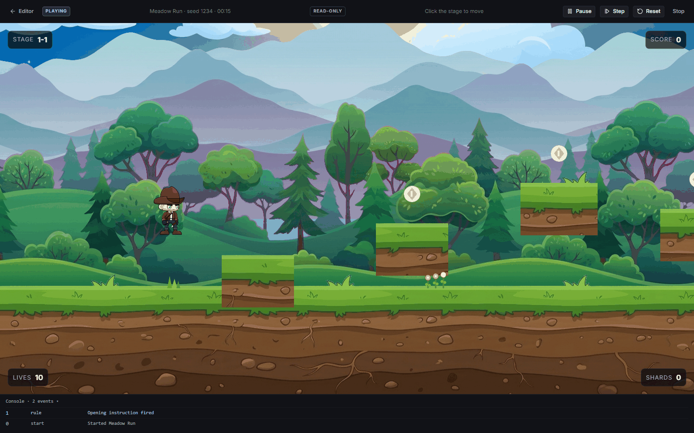
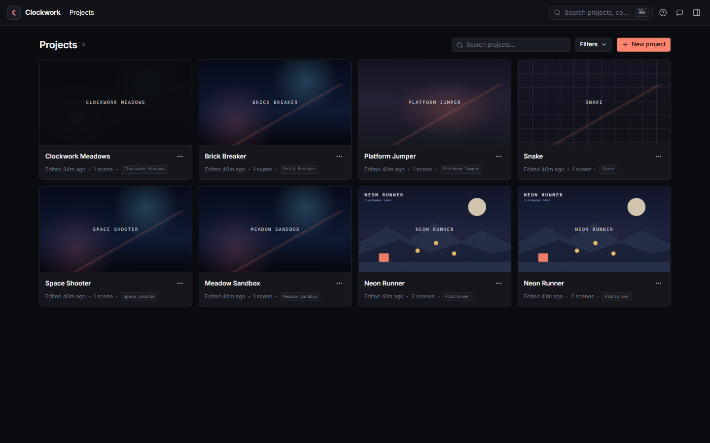
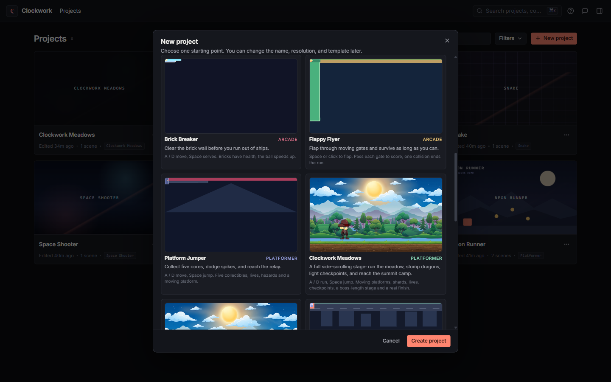
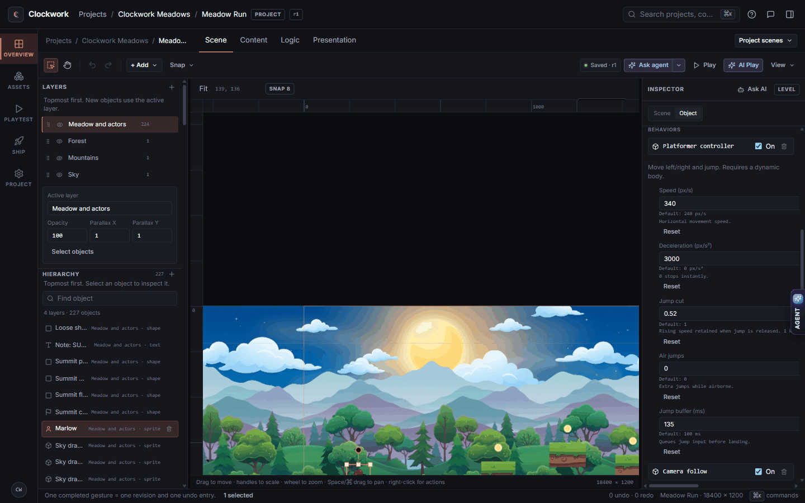
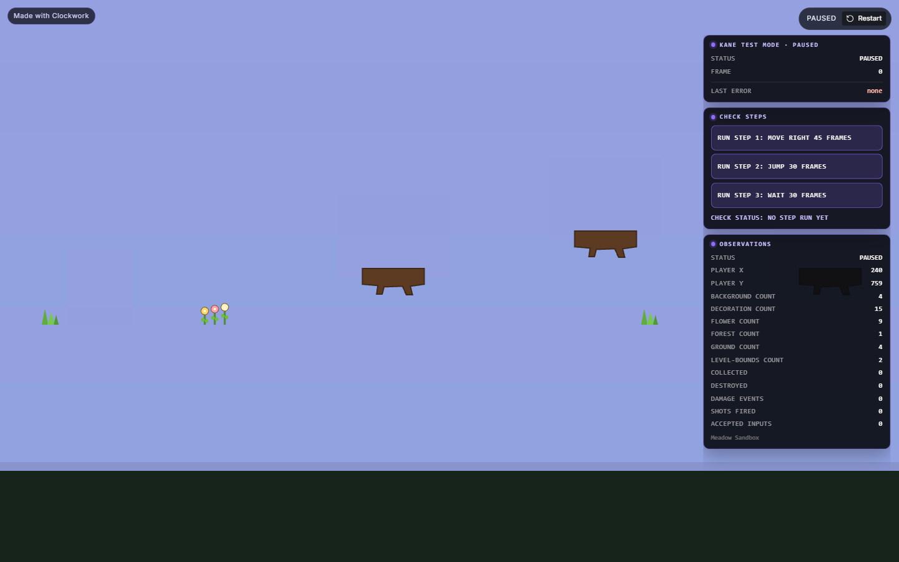
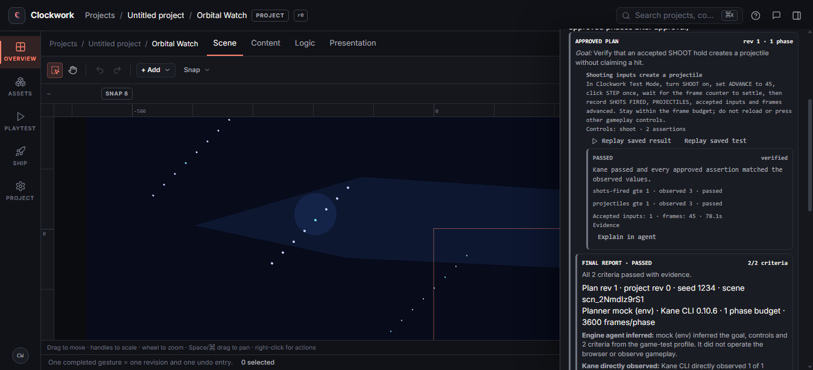
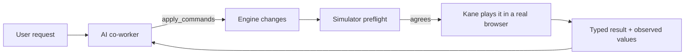
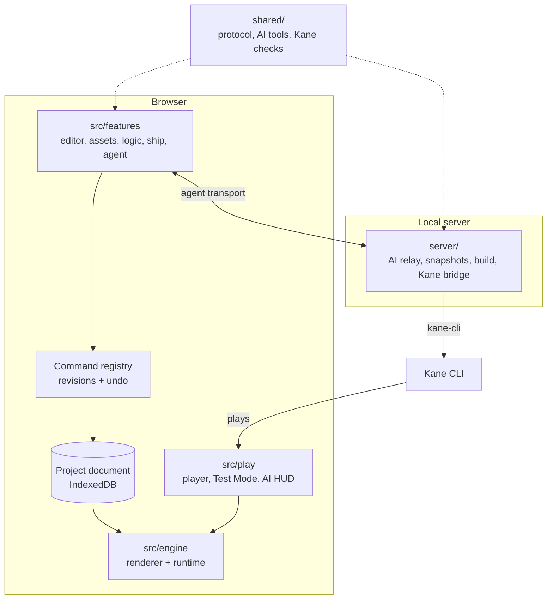

# Clockwork

**Build 2D games in your browser with a visual editor, an AI co-worker, and Kane-powered gameplay verification.**

Clockwork is a browser-native 2D game engine and editor. You build scenes visually, attach behaviours and rules, and play the result instantly. You can work alongside an AI co-worker that reads and edits your actual project. Kane CLI then plays the game in a real browser and reports back exactly what it observed. When the game is ready, you export it as a standalone ZIP or share a read-only link.

The editor, the runtime, the AI co-worker and the Kane integration form one environment and work on one shared project document.

<p align="center">
  
</p>

## Demo

**Watch the demo:** https://youtu.be/ybe9e93r4SU

| | |
|---|---|
|  |  |
| **Projects dashboard.** Every project, with its cover, scene count and template. | **Start a game.** Blank, a genre starter, a classic template or a written brief. |
|  |  |
| **Visual editor.** Layers, the scene hierarchy and the Inspector, showing the player's behaviours. | **Kane Test Mode.** The game pauses and advances an exact number of frames per step, with live readouts. |

<p align="center">
  
  <br><em>An approved AI Testing phase. Kane's verdict comes back with every assertion and the value it observed.</em>
</p>

## Why Clockwork?

Making a game involves more than placing objects on a canvas. You lay out scenes, tune movement and physics, write the gameplay logic, manage art and audio, design the HUD, then play the game again and again to check that it still works.

Clockwork puts all of that in one place. It also gives the AI co-worker the same context you have. The agent reads the live game document, including scenes, objects, behaviours, variables and HUD, and it edits through the same command system the editor uses. Every AI change is a normal project revision with a normal undo entry.

Clockwork also closes the testing gap. The agent can ask Kane CLI to play the game in a real browser, and the structured result comes back into the conversation. The agent's next step is then based on what actually happened in the game.

## Core features

### Visual game editor
A PixiJS-based viewport with selection and multi-selection, move, scale and rotate handles, snapping, zoom and pan. The editor also has a layered scene hierarchy with drag-and-drop reordering, an Inspector for every property, and full undo and redo. One completed gesture is one revision and one undo entry.

### Project creation
Start from Blank, one of 14 genre starters, one of 3 classic templates, or a written brief. The Projects page supports search, filtering, sorting, duplication and renaming. Projects import and export as `.clockwork.json` files.

### Asset management
Clockwork includes starter art and lets you import your own assets. You can search, filter and rename assets, slice sprite sheets, build animation clips, paint and edit tilemaps, and configure scene audio.

### Gameplay authoring
- **Behaviours.** 27 composable behaviours, including platformer and top-down controllers, patrol, follow, collectible, hazard, checkpoint, stompable, spawner, health, shooter, projectile, formation, ball, paddle, flap, melee, exit gate and snake.
- **Rules.** Conditions such as overlap, input, timer, scene start and variable checks, paired with actions such as setting variables, spawning prefabs, destroying objects, playing sounds, showing messages and changing scenes.
- **More building blocks.** Variables, prefabs with overrides, input bindings, gravity and collision, HUD widgets bound to variables, and scene audio.

### Game runtime
A fixed-step simulation with play, pause, resume, single-step and reset. It accepts keyboard, pointer and gamepad input. The runtime exposes observations such as player position, variables, tag counts and event counts, which Test Mode and Kane read.

### AI co-worker
Ask, Plan and Build modes, with project-aware context and awareness of scenes and objects. The agent edits through typed tools and batches its changes, with reviewable change sets and plan previews. Its presence shows in the editor, and every change uses the normal undo history.

### Export and sharing
Export a standalone game ZIP, create read-only share links backed by snapshots, and capture project covers.

## Creating a game

The New Project dialog offers four starting points:

- **Blank:** an empty scene and one layer.
- **Genre starters (14):** Space Shooter, Space Invaders, Asteroid Field, Ping Pong, Brick Breaker, Flappy Flyer, Platform Jumper, Clockwork Meadows, Meadow Sandbox, Endless Runner, Arena Survival, Falling Objects, Maze Escape and Snake.
- **Classic templates (3):** Platformer, Top-down and Puzzle.
- **From brief:** describe the game and the agent builds the first pass.

Starters are generated game documents with real scenes, objects, behaviours, rules, variables and HUD, built from the same building blocks you use yourself. **Clockwork Meadows** is the showcase: an 18,400-pixel side-scroller with parallax layers, dragons, checkpoints, sun shards and a summit finish. **Meadow Sandbox** keeps the Meadows look and leaves out the gameplay, so it's a good place to try the AI co-worker.

To customise a starter, edit it directly in the editor or ask the co-worker in Build mode.

## The built-in AI co-worker

The co-worker lives in a drawer inside the editor. It works on the same project you have open.

| Mode | What it does |
|---|---|
| **Ask** | Read-only. Answers questions about your project, such as which object is the player, what a behaviour does, or why the score doesn't change. |
| **Plan** | Drafts changes as a preview. Clockwork shows the change set and a ghost of the affected objects, and you click **Apply** or **Discard**. |
| **Build** | Applies changes such as creating objects, configuring behaviours, adding variables and rules, or building a HUD. |

**How a change happens:**

1. You describe what you want.
2. The agent inspects the project with read tools such as `get_scene`, `search_entities`, `inspect_entity`, `get_variables` and `list_commands`.
3. It applies the change with `apply_commands`. The whole batch is one atomic, revision-checked transaction.
4. The change appears in the editor, and each tool call shows as a card in the chat.
5. You keep it, or undo it like any other edit.

Manual edits and AI edits share one command registry, one revision counter and one undo history.

## Kane CLI integration: AI-assisted gameplay verification

The AI co-worker can build a mechanic, ask Kane to play it in a real browser, receive structured observations, and use them for its next step.



### How the closed loop works

1. You ask for a feature and ask the agent to verify it with Kane.
2. The agent changes the game through the normal command system.
3. It calls `verify_with_kane` with a check: a short list of steps, such as "hold MOVE RIGHT for 45 frames", and the values it expects.
4. **Simulator preflight.** Clockwork runs the same steps headlessly in the engine simulator. If the expectations don't hold, the agent gets the simulator's values and can adjust before Kane runs.
5. **Real-browser verification.** Clockwork publishes a snapshot and Kane CLI opens it in **Test Mode**. The game is paused there, and each `RUN STEP n: <CONTROL> <frames> FRAMES` button advances an exact number of frames.
6. Kane clicks each step and reads the on-page readouts using DOM assertions.
7. Clockwork compares Kane's stored values with the expectations and streams a typed verdict, with one outcome per expectation, back into the chat.
8. The agent reports the result or continues refining the game.

The simulator and the browser run the same inputs through the same runtime. A **PASSED** verdict means both agree. In a recorded run on Meadow Sandbox, the agent added coins, a score variable and a score HUD, and Kane confirmed SCORE 0 → 1 and COIN COUNT 6 → 5 after one coin was collected.

Every game has a Test Mode. Thirteen starters ship hand-written test profiles. Every other game, including ones the agent builds, gets a profile derived from the project, which exposes the standard controls and readouts for position, variables, tag counts and events.

### Kane integration paths

- **Agent-requested verification.** The co-worker calls `verify_with_kane` and receives the typed result in the conversation.
- **AI Testing (reviewed plans).** The agent drafts a bounded test plan with `propose_test_plan`. You review and approve it in the AI Testing panel. Kane then runs the approved phases one at a time in Test Mode (`run_kane_test_phase`), and each verdict and its observed values return to the agent.
- **AI Play.** A second Play button that sends Kane into a read-only snapshot of the game to play it through a visible AI HUD. It returns status, final state, steps and evidence. If a collectible is buried inside solid ground, Clockwork's repair policy can move it with one undoable edit and replay with the same seed.
- **Engine E2E.** Kane also tests the Clockwork editor itself. A saved test, `.testmuai/tests/engine-template-e2e_test.md`, creates a project from a starter, edits and undoes a value, plays the game, restarts it and returns to the editor. Run it with `pnpm kane:engine-e2e`.

## Exporting and sharing

The **Ship** panel takes a project out of the editor:

- **Standalone ZIP.** A static build of the game and its assets with the Clockwork player, ready to host on any static web server.
- **Share links.** Clockwork freezes the current project into a read-only snapshot served at `/s/<snapshotId>`. Anyone with the link plays that exact version, and later edits don't change it. You choose how long the link stays valid.
- **Project file.** Export `.clockwork.json` to back up a project or move it to another machine. It imports through New Project → Import.

## Quick start

**Prerequisites:** Node.js 20 or later and pnpm.

```bash
pnpm install
pnpm dev
```

Open **http://localhost:5173**. `pnpm dev` starts the Vite frontend and the local API server together. The API serves the agent transport, provider settings, snapshots, player bundling and the Kane bridge.

You can build and play games manually without any further configuration. The AI co-worker needs a model, and the Kane workflows need Kane CLI.

## Configuring the AI co-worker and Kane

### AI provider

Open a project and go to **Project → AI Settings** to add a provider key or a custom OpenAI-compatible endpoint, then choose a tool-capable model. Keys are stored by the local server and never reach the browser.

You can also configure a model with environment variables in `.env.local`:

```bash
AI_BASE_URL=https://api.openai.com/v1
AI_API_KEY=your-api-key
AI_MODEL=gpt-4o-mini
```

`LLM_BASE_URL`, `LLM_API_KEY` and `LLM_MODEL` work as aliases. See [docs/model-setup.md](docs/model-setup.md).

### Kane CLI

```bash
npm install -g @testmuai/kane-cli
kane-cli login
kane-cli whoami
```

Kane runs in a visible Chrome window by default. Set `KANE_HEADLESS=1` to run it headless. `KANE_CLI` points to a different Kane binary. See [docs/kane-setup.md](docs/kane-setup.md) and [docs/kane-cli-usage.md](docs/kane-cli-usage.md).

## Data and local-first storage

- **In your browser (IndexedDB):** projects, assets and agent conversations.
- **On the local server (`.data/`):** published snapshots, Kane run results and evidence, and the local key vault for provider keys.
- **`.clockwork.json`:** a portable export of a whole project for backup, sharing with collaborators, or moving between machines.

## Architecture



| Directory | Purpose |
|---|---|
| `src/engine/` | The document model and schema, the command registry, the renderer, the runtime and physics, behaviours, test profiles, and import and export. |
| `src/features/` | Editor UI: projects, scene editor, assets, logic, presentation, ship and the AI co-worker. |
| `src/play/` | The player used for Play, share links, exports, Test Mode and AI Play. |
| `server/` | The local API: model relay and key vault, snapshots, player bundling and the Kane runner. |
| `shared/` | Types shared by browser and server: the agent protocol, tool definitions and the Kane check format. |
| `scripts/kane/` | Kane test scripts, saved-test runners and the HUD layout audit. |

Every change to a project, from a mouse drag, an Inspector field or the AI co-worker, goes through one **command registry**. The registry validates the change, applies it to the project document as a new revision, and records it for undo. The renderer and runtime read from that document, and persistence saves it to IndexedDB.

## Documentation

- [Model setup](docs/model-setup.md): AI providers and configuration.
- [Kane setup](docs/kane-setup.md) and [Kane CLI usage](docs/kane-cli-usage.md): installing and operating Kane CLI.
- [AI Play](docs/ai-play.md): how AI Play and its repair loop work.
- [Game test profiles](docs/game-test-profiles.md): the controls and readouts Kane can use in Test Mode.
- [Game templates](docs/game-templates.md): the starters and templates.

## Development

```bash
pnpm dev          # frontend + local API
pnpm typecheck    # TypeScript project check
pnpm test         # unit tests
pnpm build        # production build
pnpm preview      # preview the production build
pnpm test:hud     # HUD layout audit (needs Chrome with remote debugging on port 9352)
pnpm kane:engine-e2e   # saved Kane end-to-end test of the editor (needs the dev server and Kane CLI)
```

## License

[MIT](LICENSE) © 2026 Temitope Olajide
