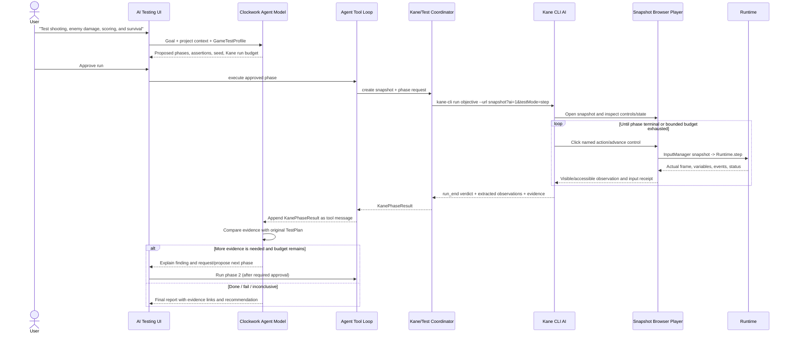

# Kane + Clockwork AI game-testing implementation plan

- **Status:** Implemented through the typed Kane phase coordinator and Test Mode. Local tests pass; the live approved-plan Kane run and adaptive follow-up still need recorded evidence. See [`demo-readiness.md`](./demo-readiness.md).
- **Date:** 2026-11-18 (implementation status updated 2026-11-21)
- **Repository branch at audit:** `feat/game-starter-templates`
- **Primary vertical slice:** Space Shooter, using the existing project model, fixed-step runtime, AI agent, AI Play snapshot flow, and Kane CLI integration.
- **Goal:** Let a user describe a gameplay test in natural language, have Clockwork's configured AI understand and plan it, have Kane CLI genuinely operate and verify the actual browser game, and feed Kane's evidence back to Clockwork's AI for a bounded next decision.

## 1. Executive summary

Clockwork already has the main ingredients for an AI-assisted game-testing product:

- A real editable project document and a deterministic fixed-step `Runtime`.
- A real-time Pixi Play page and an opt-in snapshot player.
- A built-in project-aware AI agent with read/write tools and an eight-step tool-call loop.
- A headless `start_playtest` tool for inexpensive deterministic runtime checks.
- Kane CLI integration that starts a real browser run against an immutable snapshot, streams run progress, and returns a verdict and evidence.
- An accessible AI Play HUD that routes DOM controls through the same `InputManager` as keyboard play.

The missing piece is a **unified, honest test workflow**. The current AI Play panel has no user-entered objective; it generates a narrow default goal. Its displayed model label can imply the built-in model is directing play, although the direct button does not ask that model to plan or interpret the run. The ordinary AI Play runtime advances in real time, while Kane's browser agent reasons between actions. The existing controls and telemetry also do not yet provide a general, frame-bounded test contract for all starter genres.

### Recommendation

Evolve the existing AI Play path into **AI Game Testing**, rather than building another game loop or a second agent:

1. The user enters a natural-language test objective in the editor's AI Testing experience.
2. The existing Clockwork agent inspects the actual document, its controls, variables, rules, and a small validated test profile; it produces a bounded, structured plan and asks the user to confirm the proposed Kane work and cost.
3. Clockwork creates a snapshot. Kane opens the actual snapshot player in an explicit, visible, opt-in test mode.
4. Kane clicks accessible controls that feed the actual `InputManager` and actual `Runtime`. The opt-in mode pauses while Kane thinks and advances only bounded fixed frames after a control/advance action. It changes timing and observability, not gameplay rules.
5. Kane returns its actual browser verdict, observations, and evidence. That tool result is appended to the existing Clockwork agent conversation.
6. Clockwork's agent evaluates the evidence against the user's original objective and decides whether to conclude, request a bounded follow-up Kane phase, or propose a project-content edit for user approval.

The first reliable closed loop should be **phase-level**, not a new model call for every physics frame: a short Kane browser phase produces a result; the existing agent tool loop receives that result and makes the next decision. Within a phase, Kane's own AI continues to observe the test HUD and decide which visible game control to click. The current repository provides no evidence of a persistent, bidirectional Kane CLI callback that would let Clockwork's model interrupt a live Kane action stream. Do not assume one. A capability spike can revisit this only if supported by the installed Kane CLI contract.

This division preserves the hackathon requirement: **Kane genuinely interacts with the rendered game in a real browser, and Kane's result feeds back to the built-in agent.** The headless runtime remains useful for rapid preflight and regression coverage, but it does not replace Kane or count as browser evidence.

### What the user should understand today

- The current **AI Play** button is a Kane-driven browser play probe against a snapshot, not a complete generic QA planner.
- Its objective is generated from project data; the panel does not currently have a free-form instruction field.
- The direct AI Play button does not use the selected Clockwork model to choose actions or interpret results. Kane CLI supplies its own browser agent. Clockwork currently has a deterministic, narrowly scoped auto-fix for an embedded collectible and can retry once in the panel flow.
- The built-in AI can call `run_ai_play` or `verify_with_kane` from the Agent drawer. The returned tool result is fed back into its existing model/tool loop, so this is the current route to a model-level follow-up. It is not the same as the AI Play button's UI flow, and it currently does not provide a complete multi-phase test-planning experience.
- The user's example test objective is not entered in the AI Play panel today. A user can ask the built-in agent to use a Kane tool, but there is no dedicated test-objective authoring and review flow.

## 2. Existing architecture audit

This plan is based on the code and docs listed below. Links are relative to this document.

| Area | Existing implementation | Reuse / limitation |
|---|---|---|
| Project model and templates | [`src/engine/model/schema.ts`](../src/engine/model/schema.ts), [`src/engine/model/game-starters/`](../src/engine/model/game-starters/), [`docs/game-templates.md`](./game-templates.md) | Twelve registered game starters are `ProjectDocument`s. `TEMPLATE_ORIGINS` holds 18 values: those 12 starters, 3 legacy templates the picker still offers (`platformer`, `topdown`, `puzzle`), and 3 non-template origins (`blank`, `brief`, `import`), with `blank` also createable. Profiles cover the 12 starters; the other four createable templates must report “no profile” rather than approximated controls. `INPUT_ACTIONS` currently defines `left`, `right`, `up`, `down`, `jump`, `action`. Add optional, versioned test metadata without changing existing authored gameplay. |
| Runtime | [`src/engine/runtime/runtime.ts`](../src/engine/runtime/runtime.ts) | `Runtime.step()` is fixed-step (`FIXED_DT`), deterministic when seeded, and owns variables, status, events, spawning, collision, score, and win/loss. This is the source of truth for both Play and test observations. |
| Input | [`src/engine/runtime/input.ts`](../src/engine/runtime/input.ts) | `InputManager` listens to window keyboard events, pointer events on the canvas, virtual actions, and the first standard gamepad. It supports six logical actions. `tapAction()` uses a 90 ms wall-clock timer, which is not suitable for deterministic step mode without extension. |
| Normal Play | [`src/features/playtest/PlayPage.tsx`](../src/features/playtest/PlayPage.tsx) | Runs a `requestAnimationFrame` accumulator and fixed `Runtime.step()` calls; offers pause, single-frame Step, Reset, pointer action, and click-to-move. Time advances while the player/agent reasons. The page exposes status, frame, FPS, variables, player position and frame timing as data attributes. |
| Snapshot player | [`src/features/playtest/SnapshotPlayerPage.tsx`](../src/features/playtest/SnapshotPlayerPage.tsx) | Loads an immutable project snapshot, then runs the same renderer/runtime with its own real-time RAF loop. `?ai=1` shows `AiPlayHud`. It has no bounded-frame controller today; AI HUD STOP pauses and RESTART resets. |
| AI Play HUD | [`src/play/ai/AiPlayHud.tsx`](../src/play/ai/AiPlayHud.tsx) | Visible, accessible `MOVE LEFT/RIGHT`, `JUMP`, `ACTION`, `STOP`, `RESTART` controls. Held controls use `InputManager.setAction`; impulses use `tapAction`. It is valuable prior art, but generic `ACTION` is less expressive than game-specific labels, and AI Play is currently wall-clock driven. |
| Headless playtest | [`src/engine/runtime/playtest.ts`](../src/engine/runtime/playtest.ts) | Runs the same `Runtime` with a seed and timestamped logical inputs, without a renderer/browser. It is capped at 15 seconds and returns status, variables, events and error data. It is a fast logic/preflight test, not Kane execution or visual evidence. |
| Built-in agent | [`src/features/agent/useAgentSession.ts`](../src/features/agent/useAgentSession.ts), [`shared/ai-tools.ts`](../shared/ai-tools.ts), [`server/ai/system-prompt.ts`](../server/ai/system-prompt.ts) | The configured project model receives project context and tool results. The client tool loop appends each tool result and asks the model again, up to eight tool-loop iterations per user turn. `start_playtest` is headless; `run_ai_play` and `verify_with_kane` launch Kane. |
| Agent tool result loop | [`src/features/agent/useAgentSession.ts`](../src/features/agent/useAgentSession.ts) | A completed Kane result is serialized into a tool message in the same conversation. The next agent iteration receives it and can inspect, explain, edit, or request another tool. This is reusable closed-loop plumbing, but it currently operates after a Kane tool call completes. |
| AI Play UI | [`src/features/ai-play/AiPlayPanel.tsx`](../src/features/ai-play/AiPlayPanel.tsx), [`src/features/ai-play/useAiPlay.ts`](../src/features/ai-play/useAiPlay.ts) | Shows a generated objective, progress, attempts, final state, and evidence. There is a Copy objective button, but no editable objective field. The panel displays the Clockwork model label, but the button flow does not call that model to plan or analyze the run. |
| Kane objective builder | [`server/kane/objectives.ts`](../server/kane/objectives.ts) | Generates a short default objective from a few project fields (collectibles/HUD/win variable) or accepts a goal through tool/API paths. It is not a general mechanics-to-test-plan compiler. |
| Kane server integration | [`server/routes/kane.ts`](../server/routes/kane.ts), [`server/kane/runner.ts`](../server/kane/runner.ts), [`shared/protocol/kane.ts`](../shared/protocol/kane.ts), [`src/engine/ai/kane-api.ts`](../src/engine/ai/kane-api.ts) | Server creates a snapshot URL and starts a bounded `kane-cli run --agent` or configured saved `testmd run`. It parses NDJSON, persists result/log/evidence files under the configured evidence root, and streams progress/final result. It does not expose a live action callback to Clockwork's model. |
| Snapshot and repair | [`src/engine/io/snapshot.ts`](../src/engine/io/snapshot.ts), [`src/engine/ai/ai-play-repair.ts`](../src/engine/ai/ai-play-repair.ts) | Play is isolated from live editor state. The repair helper detects a collectible overlapping a static/kinematic solid and proposes a single undoable transform update; it is not a general gameplay diagnosis or repair engine. |
| Kane history and constraints | [`docs/kane-proof.md`](./kane-proof.md), [`docs/ai-play.md`](./ai-play.md), [`docs/testing-hooks.md`](./testing-hooks.md) | Real runs show Kane startup and step latency are significant. The ledger records unreliable keyboard delivery in a previous flow and reliable click delivery; click-to-move was added to normal Play. Saved `_test.md` replay can avoid some re-authoring cost but does not make live gameplay real-time. |
| Automated tests | [`tests/`](../tests/), `npm test` | 52 local tests currently pass, including deterministic starter/runtime coverage. Tests use Node's runner and the real headless Runtime; they do not prove browser input delivery, canvas rendering, Kane interaction, or evidence quality. |

### 2.1 Two existing gameplay paths that must not be conflated

```text
Headless engine test:
Clockwork agent -> start_playtest -> Runtime.step(InputFrame...) -> variables/events
                 no browser, no Pixi, no Kane, no screenshot evidence

Kane AI Play:
Editor -> immutable snapshot -> Kane CLI -> Chrome snapshot player
        -> AiPlayHud clicks -> InputManager -> real Runtime + Pixi
        -> Kane run_end/evidence -> result shown in AI Play panel
```

The headless path is valuable for deterministic rules and fast regression tests. The Kane path is necessary to demonstrate browser rendering, accessible controls, real browser interaction, and Kane evidence. A passing headless result must never be shown as a Kane pass.

## 3. Current AI Play: what it actually does

### 3.1 Click-to-result flow

1. The AI Play panel asks for consent to use the signed-in Kane CLI, launch Chrome, and consume TestMu AI credits.
2. `useAiPlay` checks Kane CLI status, saves the current project, collects assets, and creates a one-hour immutable snapshot.
3. It fetches the generated objective from `/api/kane/ai-play/objective/:snapshotId`.
4. The server builds a Kane objective from document heuristics and starts Kane at `/s/:snapshotId?ai=1&seed=1234`.
5. Kane interacts with the real rendered snapshot page. The AI HUD presents state and DOM controls; HUD actions call the snapshot page's `InputManager`.
6. The Kane runner parses progress and the terminal result, captures final state/evidence references, and returns the result to the panel.
7. With panel Auto-fix enabled, the editor-side workflow may apply the existing deterministic embedded-collectible repair to the live project and run a second snapshot attempt. The original Kane failure remains visible; the fix can be undone.

### 3.2 Which AI decides what

There are two distinct model/agent roles:

- **Kane's browser agent** is responsible for following the Kane objective, observing the page, deciding browser actions, clicking controls, and producing the Kane verdict/evidence. The Kane CLI is started by the server integration.
- **Clockwork's configured model** powers the built-in Agent drawer. The direct AI Play panel's `modelLabel` is display metadata; the panel does not submit a planning prompt to that model before launching Kane or ask it to interpret Kane's completed result.

The built-in model can participate when the user speaks to the Agent drawer and it calls `run_ai_play` or `verify_with_kane`. In that path, the Kane tool result is appended to the agent conversation and the existing model/tool loop continues. This is an actual integration point and should be reused, not replaced with a second project-agent implementation.

### 3.3 What world information is available

- The server uses a small subset of the snapshot document to build the default objective: project/scene, collectible count, visible HUD labels, and a likely win variable.
- Kane observes the rendered browser page and accessible AI Play HUD. It does not receive a general semantic map of every runtime entity and game rule from Clockwork.
- The snapshot player exposes status, scene, frame, variables and player position as data attributes. The AI HUD exposes status, scene, coins, health, time, seed and last error as named DOM values.
- The built-in AI, when invoked through the Agent drawer, can inspect project scenes, objects, variables and rules using its normal project read tools. That knowledge is not currently passed as a comprehensive game-test profile to the direct AI Play panel.

### 3.4 Objective input and actual testing scope

- The direct AI Play button has no natural-language test objective field. It shows a generated objective and lets the user copy it.
- The default objective is a narrow goal/completion probe. `buildAiPlayObjective` favors collectible count plus a won status, and falls back to a likely win variable. It does not plan a complete test of shooting, damage, enemy AI, balance, every win/loss path, or editor changes.
- A user can ask the built-in Agent to call `run_ai_play` with a `goal`, or use `verify_with_kane` with a custom objective. These are currently separate from the dedicated AI Play objective UI.
- `start_playtest` is a different tool: it runs a seeded, timestamped-input simulation against `Runtime` directly, without Kane or a browser.

### 3.5 Findings, repairs, and limitations

- A successful Kane `run_end` and evidence link are useful browser evidence for the stated objective. They do not prove every mechanic or full game quality.
- The panel returns progress, final state, summary, duration, Kane steps, and evidence links. It does not produce a comprehensive per-mechanic QA report or automatically diagnose arbitrary gameplay defects.
- The existing Auto-fix is deterministic and narrow: it moves one collectible embedded in a solid. It is not the Clockwork model generating a repair, and it must not be presented as general AI diagnosis.
- The tool definition for `run_ai_play` now states that each call performs exactly one run and that the model may retry once after a repair. The Agent execution path streams one Kane result and returns it to the model; the panel's Auto-fix loop remains a separate path.
- **Fixed in Phase 0:** `run_ai_play` forwards `goal` and `sceneId` end to end (tool call → `streamAiPlay` → `POST /api/kane/ai-play` → `buildAiPlayObjective`), and `maxAttempts` was removed from the schema and docs because a same-input retry inside one call can only reproduce a seeded result. `verify_with_kane` still advertises a `sceneId` it does not forward; that remains open.
- **Fixed in Phase 0:** `toResult` in `server/kane/runner.ts` no longer infers `passed` from exit code 0. `passed` requires a `run_end`; a missing terminal event is `error` with an explicitly unknown verdict, and timeout/cancel stay `cancelled`. Input-receipt and evidence gating for the new test contract are still unimplemented.

## 4. Current Kane CLI integration

`server/routes/kane.ts` validates Kane availability/authentication, retrieves a server-stored snapshot, constructs a server-controlled URL, and starts `startKaneRun`. `server/kane/runner.ts` invokes either:

- `kane-cli run <objective> --url <snapshot-url> --agent ...`, or
- configured `kane-cli testmd run <saved-test> --url <snapshot-url> --agent ...`.

The runner parses the CLI's NDJSON stream and returns a `KaneEvent` sequence including progress and a terminal `run_end`. It persists run artifacts under `.data/ai-play` (configurable). `shared/protocol/kane.ts` currently models a result with status, summary, final state, steps, runtime errors, evidence references, duration, and ids.

Important boundaries:

- Kane is actually launched in its own browser run; this is not a simulated Kane result.
- Kane uses the snapshot URL, so its actions do not mutate the editor document.
- The server streams progress to the panel, but progress events are not currently structured per game action and do not give Clockwork's model an intermediate game-state callback.
- The current integration has a hard timeout and max-step cap. Run limits must remain explicit and bounded.
- Saved-test replay can reduce repeated authoring cost. It is not proof of interactive adaptation and may not be suitable for goals that change after observing a failure.
- The app is currently local/self-hosted for AI Play because it launches a local Kane CLI/browser.

## 5. Identified problems and architectural gaps

1. **No clear user-authored objective in AI Play.** The main button uses a generated probe; custom instructions are reachable only indirectly through the built-in Agent tools.
2. **Ambiguous AI ownership.** The panel displays a Clockwork model label next to a Kane run even though the direct button does not call that model. Users can reasonably think Clockwork's AI chose the actions.
3. **Runtime clock outruns Kane.** Both normal Play and snapshot AI Play progress through a real-time RAF loop. Kane's reasoning/action delay can exceed a game's survivability window.
4. **Keyboard delivery is unreliable in the recorded Kane flow.** The proof ledger records that Kane key presses did not reach Play in a run while clicks did; the player stayed still. A Runtime unit test for a one-frame press edge does not prove Kane's browser keyboard delivery.
5. **Current AI HUD impulses use wall time.** `tapAction()` sets a timeout for release. That introduces wall-clock dependence into a mode intended to advance only fixed simulation frames.
6. **Controls are generic.** `ACTION` does not tell Kane whether it shoots, attacks, serves, flaps, or interacts. Control labels and hold/pulse semantics need to be described by the game document/profile.
7. **Observability is partial.** Data attributes expose basic runtime state, but there is no explicit delivered-input acknowledgement, test event feed, assertion result list, or standardized selected-entity observation.
8. **No shared test contract.** The project has no validated format linking a user's natural-language request to allowed controls, scenario setup, observations, assertions, budgets, and Kane evidence.
9. **Closed loop is available but not productized.** The Agent tool loop can receive a completed Kane result and continue reasoning. The direct AI Play panel has no such model step. Neither path currently turns a goal into a reviewed test plan followed by bounded adaptive Kane phases.
10. **Auto-fix is not general analysis.** The deterministic collectible repair is useful as a demo repair but cannot safely diagnose shooting/collision/scoring failures.
11. **Result truth needs stronger rules.** A browser/tool error, missing `run_end`, failed input delivery, or missing evidence must not become a pass because a process exited successfully or some unrelated status was visible. The exit-code fallback is fixed in Phase 0; input receipts and evidence requirements are still unenforced.
12. **No reliable all-genre metadata.** Six logical input actions cover the current starters, but future games may need aiming, pointer targets, drag, combos, or additional buttons.
13. **Unbounded retries are a risk.** The agent loop is capped, but testing needs explicit limits for Kane invocations, frames, time, and user cost.

## 6. Proposed unified AI architecture

### 6.1 Components and ownership

```mermaid
flowchart LR
  U[User: natural-language test goal] --> UX[AI Testing panel]
  UX --> CA[Clockwork project AI]
  CA -->|inspect document + test profile| DOC[ProjectDocument / GameTestProfile]
  CA -->|validated TestPlan; user confirms| ORCH[Test-session coordinator]
  ORCH -->|immutable snapshot + bounded phase objective| KCLI[Kane CLI agent]
  KCLI -->|real browser navigation, clicks, assertions| PAGE[Snapshot player: visible Kane Test Mode]
  PAGE -->|same logical InputManager| INPUT[InputManager]
  INPUT -->|InputFrame at fixed frame boundary| RT[Actual Runtime + Pixi renderer]
  RT -->|state, events, input receipt| PAGE
  PAGE -->|DOM observations and visible result| KCLI
  KCLI -->|run_end + evidence + observed result| ORCH
  ORCH -->|structured KanePhaseResult tool message| CA
  CA -->|conclude, next phase, or proposed edit| UX
```



The runtime is the source of truth; the page renders and exposes state; Kane is the browser operator/verifier; Clockwork AI is the project-aware planner and feedback interpreter. Neither AI should claim a result without evidence.

### 6.2 Required division of responsibility

**Clockwork's built-in AI**

- Understands the user's test goal and the project document.
- Reads a versioned test profile, controls, objective facts, rules, variables, and relevant objects.
- Produces a validated, bounded test plan and explains what it will test.
- Selects the next *test phase* based on actual Kane result data.
- Interprets evidence and distinguishes product failures from automation failures.
- Recommends a fix or creates a project-content edit preview. It must not silently change the game or label a proposed fix as verified.

**Kane CLI**

- Opens the real snapshot player in Chrome using the actual Kane CLI.
- Reads the visible game and accessible test HUD.
- Clicks accessible game controls and performs browser assertions.
- Verifies action-delivery receipts and observable outcomes; captures evidence through Kane.
- Returns actual `run_end`/saved-test verdict, steps, final extracted values, and evidence references.
- Does not receive credentials or arbitrary engine mutation APIs. It does not bypass the UI to call `Runtime.step()` or set game variables.

**Clockwork engine / coordinator**

- Validates the test profile, test plan, controls, scenario, limits, and snapshot ids.
- Offers an explicit opt-in lockstep mode that pauses the actual runtime between bounded advances.
- Emits reliable DOM observations from actual runtime state and confirms input acceptance.
- Runs Kane, stores its actual evidence, returns a typed result to the built-in agent, and enforces limits/idempotency.
- Does not choose the game outcome, score, or win/loss condition on behalf of Kane.

### 6.3 No duplicated gameplay engine

Do not add a second gameplay loop, a Kane-only physics implementation, or an internal bot that claims to be Kane. The following remain distinct:

- `Runtime.step(InputFrame)` is the gameplay implementation.
- `runHeadlessPlaytest()` is a fast deterministic test of that implementation.
- Kane Test Mode is a browser controller for the same `Runtime` and real renderer.
- Clockwork's AI is the test planner/analyst; Kane's AI is the browser operator.

## 7. Built-in AI and Kane CLI responsibilities

| Question | Built-in Clockwork AI | Kane CLI |
|---|---|---|
| What does the user want tested? | Interprets the user's natural-language request and preserves it as the root goal. | Receives a concise browser-phase objective derived from the validated plan. |
| What game is this? | Inspects the `ProjectDocument`, rules, variables, behaviors, and `GameTestProfile`. | Observes the rendered page, controls, HUD and accessible test-state panel. |
| Which test should run next? | Proposes and validates a phase, including expected observations and stop conditions. | Chooses browser actions within the phase objective and the available visible controls. |
| Who sends actual game input? | Does not. It may plan logical action intent. | Clicks the UI controls. The controls feed the same `InputManager` used by normal play. |
| Who decides how game logic behaves? | Does not override it. | Does not override it. The actual `Runtime` decides movement, collision, damage, score, and status. |
| Who observes action delivery? | Receives structured receipts and the final Kane report. | Verifies the visible receipt and observed outcome in the browser. |
| Who decides whether the phase passed? | Evaluates Kane's verdict against the plan's explicit criteria; unknown evidence means inconclusive. | Must return a real Kane verdict and evidence. |
| Who repairs the game? | Suggests or previews a document-level edit; user approval is required before applying a general fix. | Does not edit the project. |

## 8. Closed-loop execution architecture

### 8.1 Initial implementable loop: bounded Kane phases

The codebase already supports the essential model feedback handoff: `useAgentSession` awaits an Agent tool, serializes its result as a tool message, then continues its model loop. Reuse that. A single Kane CLI run is currently a one-shot subprocess; its NDJSON progress is streamed to the UI but there is no demonstrated per-action callback into the Clockwork model. Therefore:

- Kane can reason and act iteratively inside one bounded browser phase.
- When Kane returns `run_end`, Clockwork's agent receives the structured result.
- Clockwork's agent then decides whether to conclude or request a small number of new Kane phases.
- Each follow-up phase is bounded, uses a deterministic seed/scenario, and points to its own evidence. Do not pretend Clockwork re-planned mid-run unless a supported live CLI interface is later proven.

This is a genuine feedback loop, not a one-way script: the Kane result is input to the next Clockwork model iteration and can alter the next test phase. Keep the cap small (initially one plan plus at most two follow-up Kane phases) because every additional Kane run costs time/credits.

### 8.2 Sequence diagram



### 8.3 What “tighter is better” means here

The first implementation should close the loop at **the end of each focused Kane phase**, not after a full uncontrolled 60-second playthrough and not on every physics frame. A phase should answer one question, such as “Did an accepted shoot input produce a projectile?” or “Did that projectile destroy this enemy and increment score?” That gives the Clockwork AI actionable evidence quickly. A later phase can test survival or reset.

Do not call the engine model once per fixed frame. Do not launch a Kane process per button press. Both would add latency/cost and make the system fragile. If the hackathon requires feedback finer than phase-level, first prove that Kane CLI offers a supported persistent bidirectional protocol; the inspected integration only shows one-shot `run`/`testmd run` subprocesses and terminal results.

### 8.4 Loop state and termination

Persist one `TestSession` record per user test. Keep the original user goal immutable. Every phase result must reference the session, plan version and phase. A follow-up cannot silently replace the user's criteria.

Initial hard limits:

- Maximum 3 Kane phases per user-approved session (initial plus 2 follow-ups).
- Maximum Kane steps and wall-clock time per phase must be set by server config.
- Maximum fixed frames per single browser advance and per phase are validated server-side.
- One active test session per project (reuse the existing per-project exclusion pattern).
- No retry on `INCONCLUSIVE` without a user-visible cause and confirmation; an infrastructure retry must be separate from a gameplay retry.
- The model must finish with PASS, FAIL, or INCONCLUSIVE; it must never loop indefinitely.

## 9. User experience and testing objective input

### 9.1 Product recommendation

Evolve the existing panel into **AI Testing** (or **AI Game Test**) so users understand it tests a declared goal, not that an autonomous AI simply “plays” a full game. Keep manual Play separate and always available. The existing AI Play snapshot behavior can remain as a default quick-start test preset during migration.

Do not build a parallel chat/model surface. Reuse the Agent drawer, project model selector, `useAgentSession`, and Kane panel/tool result cards. The testing panel should make the user goal and Kane consent explicit.

### 9.2 Proposed flow

1. User opens AI Testing from the editor/Play area.
2. A text field accepts a goal, e.g. “Verify shooting creates a projectile, a hit destroys an enemy and adds score, then check that the player can survive for ten seconds.”
3. The UI shows genre-aware suggested tests from the profile (shooting, scoring, damage, survival, loss/reset); suggestions are not silently run.
4. Clockwork AI reads the project and returns a concise plan:
   - phase order and expected observations;
   - selected scenario/seed and why;
   - controls Kane will use;
   - Kane phase/step/time budget and approximate run count;
   - parts that cannot be observed or verified.
5. User edits/approves the plan and explicitly consents to Kane CLI/credit use. For the demo, show that the model being used for planning is the Clockwork model and the browser runner is Kane CLI.
6. The user sees phase status, current Kane objective, accepted input receipts, observations, Kane steps, evidence links and results.
7. After a phase, Clockwork AI says what the evidence establishes, then requests/starts the next approved bounded phase or concludes.
8. The final report lists passed, failed and inconclusive criteria separately, with evidence per criterion and a recommended next action.

### 9.3 Avoid misleading presentation

- Replace generic “KANE PLAY” presentation with “AI TEST”/“AI TESTING” for this objective-driven workflow.
- Do not label the Clockwork model as the Kane model. Show separate badges: “Planner: <Clockwork model>” and “Browser agent: Kane CLI”.
- Show the generated objective and phase plan before launch; keep the existing Copy objective affordance.
- Preserve consent, stop/cancel and evidence access.
- Do not hide a failure behind the auto-fix retry. Report the first failure, candidate fix, user approval, and replay result as separate attempts.

## 10. Kane Test Mode

### 10.1 Scope and safety

Test Mode is an explicit, visible, opt-in mode on an immutable snapshot URL, e.g. `?ai=1&testMode=step&seed=1234`. It must not activate on normal `/play/:projectId` or exported players unless a user explicitly starts the feature. Display a persistent “KANE TEST MODE · SNAPSHOT · PAUSED/FRAME N” indicator.

Test Mode changes **when** the runtime advances, not the game rules. It must not:

- set health, score, win, loss, enemy damage, or collision outcomes directly;
- make the player invincible, auto-fire, teleport, or auto-play;
- expose a hidden JavaScript API that Kane uses to mutate runtime state;
- allow an arbitrary URL or browser-side snapshot injection.

### 10.2 Lockstep behavior

1. Construct the actual `Runtime` from the server-validated snapshot and deterministic seed.
2. Initialize it paused before the first simulation frame; render the initial frame and accessible status.
3. An accessible Kane control selects a declared logical action. A bounded **Advance N frames** control steps the actual runtime by `N` fixed `FIXED_DT` ticks.
4. Every tick obtains an `InputFrame` from the same `InputManager` used by normal play. The test controller must support simultaneous held actions and explicit press/release edges.
5. After the requested bounded chunk, pause and publish frame, status, variables, player state, relevant events, accepted input sequence, and frame range.
6. Kane reasons against the paused, stable result and chooses the next browser click.
7. Stop, Reset, browser close, timeout and terminal win/loss all clear held/queued test input.

Existing Play has a single-frame Step control, but snapshot AI Play does not. Reuse a shared runtime stepping/controller primitive rather than maintaining different test-only physics.

### 10.3 Deterministic actions, not wall-clock pulses

The current `InputManager.tapAction()` releases an impulse after a 90 ms `setTimeout`. That is unsuitable when simulation time is paused. Add a frame-counted pulse/queued-input mechanism or an equivalent test controller integrated at the `InputManager` boundary:

- `hold(action, frames)` persists through the specified simulation frames, then releases.
- `press(action)` creates a `pressed` edge on the next simulated frame and a release edge on a defined subsequent frame.
- Multiple actions may be combined in one frame sequence.
- A request with zero, negative, non-integer, excessive frames, unknown action, conflicting input or stale session id is rejected visibly.
- The controller returns accepted/rejected status and exact input/frame sequence. A DOM click alone is not proof that the action reached the runtime.

Do not directly duplicate gameplay action handling in a Kane-only event listener. Normal keyboard, pointer, virtual HUD and Test Mode must converge on the same logical `InputFrame` and `Runtime.step()`.

### 10.4 Scenarios

Use a small server/code-registered scenario catalog associated with a game-test profile, not arbitrary query-string commands. Scenarios may create reproducible starting conditions on a derived test snapshot (e.g. a stationary target at known range), but the tested projectile, movement, collision, health and scoring behaviors still run normally.

Every result must display:

- base project revision/snapshot id and seed;
- scenario id and purpose;
- exact allowed setup differences from the authored project;
- which criteria are valid only for the scenario and which represent the normal game.

Run a baseline scenario before a specialized scenario when the claim concerns overall playability. Do not claim that a fixture scenario proves the untouched full game is balanced or survivable.

## 11. Data contracts and communication protocol

The following are proposed v1 contracts, not existing types. Keep them Zod-validated and versioned; do not use free-form model-generated executable code.

### 11.1 `GameTestProfile` (document-level contract)

Add an optional, versioned `gameTest` profile to `ProjectDocument` (or an equivalent normalized registry keyed by `templateOrigin` if the profile should not be user-editable). The decision should preserve import compatibility and avoid duplicating the behavior catalog.

```ts
interface GameTestProfile {
  version: 1;
  controls: Array<{
    id: string;
    label: string;                  // e.g. "SHOOT", "MOVE RIGHT"
    action: InputAction;             // initially one of the six existing logical actions
    mode: "hold" | "pulse";
    description: string;
  }>;
  observations: Array<{
    id: string;
    label: string;
    source: "status" | "variable" | "player" | "event-count" | "tag-count";
    key?: string;                    // validated variable/event/tag key
  }>;
  objectives: Array<{
    id: string;
    title: string;
    description: string;
    assertionIds: string[];
  }>;
  scenarioIds: string[];             // references a code-registered scenario catalog
}
```

Initial v1 should use the existing six logical actions. Add custom action/plugin support only when a game actually needs a capability outside them (aim pointer, drag, analog axis, or multi-button chord). A profile can label a logical action according to the game, e.g. `action` as “SHOOT” or “ATTACK”; it cannot change the underlying action semantics.

Observations must be allowlisted/read-only. A profile may refer to a numeric variable, known runtime status, selected player fields, event count, or tagged entity count. It must not run arbitrary JavaScript or expose unrestricted `Runtime` internals to the browser agent.

### 11.2 `TestPlan`

```ts
interface TestPlan {
  version: 1;
  sessionId: string;
  projectId: string;
  sourceRevision: number;
  snapshotId: string;
  sceneId: string;
  seed: number;
  userGoal: string;                 // immutable root instruction
  scenarioId?: string;
  phases: Array<{
    id: string;
    purpose: string;
    kaneObjective: string;          // short, browser-executable objective
    allowedControlIds: string[];
    assertions: Array<{
      id: string;
      observationId: string;
      operator: "eq" | "neq" | "gt" | "gte" | "lt" | "lte" | "increased";
      expected: string | number | boolean;
    }>;
    stopWhen: Array<"passed" | "failed" | "lost" | "won" | "budget-exhausted">;
  }>;
  budget: {
    maxKanePhases: number;          // v1 <= 3 per approved session
    maxKaneStepsPerPhase: number;
    maxWallTimeSecondsPerPhase: number; // v1: soft 120 s, hard 140 s per phase
    maxFramesPerAdvance: number;
    maxFramesPerPhase: number;
  };
}
```

The built-in AI may propose the plan but the client/server validate every control, scenario, observation, assertion, and budget against the profile and hard server limits. If the model proposes an unsupported mechanic, mark it “not testable with current profile” and ask the user; do not silently approximate it.

### 11.2.1 Per-phase time budget, measured

Earlier drafts sized phases without numbers. [`docs/kane-proof.md`](./kane-proof.md) now fixes the floor: Kane spends a fixed ~27–30 s on startup per run, ~10–15 s per agent step, and a 5–6 step pass lands at 66–85 s. `KANE_TIMEOUT_SECONDS` defaults to 180 s, while the AI Play route already clamps a run to `min(KANE_TIMEOUT_SECONDS, 140)`.

| Case | Measured | Budget decision |
|---|---|---|
| Passing attempt, 5–6 steps, assert-only | 66.6 s | 90 s estimate, 120 s soft cap |
| Passing attempt with `store ... as` extraction (2 extra steps) | 86.8 s | 90 s estimate, 120 s soft cap |
| Failing attempt of the same length | 85.0 s | 120 s soft cap |
| Fail → fix → pass loop, assert-only | 151.6 s (85.0 + 66.6) | session budget, not a phase |
| Fail → fix → pass loop with extraction | ~172 s | leaves ~8 s against the old 180 s session plan |
| 12-step engine-QA run | needs `KANE_TIMEOUT_SECONDS=300` | outside AI Play phase budgets |

Consequences for the `budget` contract:

- `maxWallTimeSecondsPerPhase` is 120 s soft and 140 s hard. A lower cap is not allowed: a 50 s cap killed runs that were already on track, and startup alone consumes ~30 s.
- `maxKanePhases: 3` stays, but the session budget must be quoted as a worst case, not one run: 3 × 140 s = 420 s of Kane wall time, with a typical all-pass session at ~255 s (3 × 85 s).
- A two-attempt repair loop is a session-level cost and must be counted against the 3-phase cap, because with extraction it already consumes ~172 s.
- Saved-test replay is the only measured way to buy headroom, and its timing is still unmeasured, so no plan may depend on it yet.
- A phase in `INCONCLUSIVE` from timeout does not get an automatic retry; retrying spends budget without new evidence.

### 11.3 Kane phase request and result

```ts
interface KanePhaseRequest {
  sessionId: string;
  phaseId: string;
  snapshotId: string;
  planVersion: number;
  seed: number;
  scenarioId?: string;
  objective: string;
  maxFrames: number;
  idempotencyKey: string;
}

interface KanePhaseResult {
  sessionId: string;
  phaseId: string;
  status: "passed" | "failed" | "inconclusive";
  kane: {
    runId: string;
    status: "passed" | "failed" | "cancelled" | "error";
    summary: string;
    steps: KaneStep[];
    evidenceUrl?: string;
    testUrl?: string;
    durationMs: number;
    exitCode?: number;
  };
  inputReceipts: Array<{
    controlId: string;
    action: InputAction;
    requestedFrames: number;
    accepted: boolean;
    firstFrame?: number;
    lastFrame?: number;
    reason?: string;
  }>;
  observations: Array<{
    observationId: string;
    label: string;
    value: string | number | boolean | null;
    frame: number;
    source: "runtime-dom";
  }>;
  assertions: Array<{
    assertionId: string;
    status: "passed" | "failed" | "inconclusive";
    expected: unknown;
    actual: unknown;
    evidenceRef?: string;
  }>;
  failureClass?: "product" | "input-delivery" | "kane-infra" | "timeout" | "missing-evidence" | "invalid-plan";
  evidence: Array<{ kind: "pack" | "screenshot" | "test-manager"; url?: string; ref?: string }>;
}
```

Use existing `AiPlayResult`/`KaneEvent` fields where appropriate. Add typed protocol fields rather than parsing important results back out of prose. A missing `run_end`, missing evidence, missing input receipt, or missing required observation cannot produce PASS.

### 11.4 Persisted `TestSession`

Persist a compact server-side record under a gitignored `.data/ai-testing/<sessionId>/` directory, following the existing `.data/ai-play` pattern:

- root objective, project revision, snapshot id, plan version, seed, scenario;
- plan and phase request/result records;
- Kane run ids, evidence-pack/test-manager references, and timestamps;
- status and budgets used/remaining;
- user approvals and any proposed/applied project repair transaction ids.

Persist no provider credentials. Treat raw Kane CLI artifacts as sensitive local test data; do not commit them. Idempotency keys prevent duplicate clicks/submissions from launching duplicate Kane runs.

## 12. Space Shooter vertical slice

### 12.1 User story to demonstrate

> “Test whether shooting works, enemies can be destroyed, scoring updates correctly, and the player can survive a short incoming-enemy encounter. Report anything you could not verify.”

### 12.2 Proposed execution

1. User opens AI Testing. Clockwork AI inspects the Space Shooter document and its test profile: player controls, shooter behavior, enemy health/score behavior, variables, and HUD.
2. Clockwork AI proposes:
   - **Phase 1 – Input/projectile:** accepted SHOOT pulse results in a projectile event/entity.
   - **Phase 2 – Hit/score:** a projectile reaches a real enemy; enemy health/death and score change are observed.
   - **Phase 3 – Survival/reset (optional within budget):** a short incoming-enemy sequence is advanced; health/loss/reset behavior is checked.
3. The plan shows scenario, seed, expected observations, Kane run count and a consent/cost checkpoint. The user approves.
4. The engine saves and snapshots the exact project revision. If a shooting-range scenario is needed, it is explicitly identified and shown as a derived setup. It must not directly decrement enemy health or award score.
5. Kane opens the snapshot player, reads “KANE TEST MODE · PAUSED”, verifies the controls and current observation, clicks **SHOOT**, and clicks a bounded **ADVANCE** control.
6. Runtime confirms the accepted action/frame and records projectile creation. Kane observes the receipt and rendered projectile; if absent, it stops that criterion rather than claiming success.
7. Kane repeats with enough bounded frames to hit an actual target. It extracts status/score/enemy observations and asserts expected changes; the browser captures real evidence.
8. Kane returns its result and evidence. The Clockwork agent receives it as a tool result in the current conversation. It interprets, for example, “input was accepted but no projectile appeared” differently from “input was never delivered.”
9. Based on that result, Clockwork either concludes, requests one follow-up diagnostic phase, or proposes a project-document fix. A fix is previewed/approved; the next Kane phase uses a new snapshot at the new revision. Before/after evidence is linked.
10. Final report lists each criterion PASS/FAIL/INCONCLUSIVE and the exact Kane evidence. A headless `start_playtest` result may be attached as supporting runtime evidence, clearly labeled non-browser.

### 12.3 What this demonstrates to judges

- Clockwork's model reads actual game data and plans a mechanics-focused strategy.
- Kane CLI opens a real browser and clicks visible game controls; it is not merely invoked in the background.
- The runtime performs the actual physics, projectile collision, enemy health/death, scoring, and status updates.
- The test clock is deterministic and does not let the game kill the player while Kane thinks.
- Kane's observed result and evidence are passed back into the Clockwork agent's tool loop, and the subsequent phase/diagnosis visibly changes in response.
- Failures and unknowns remain visible; no hidden success, auto-play or unearned PASS.

## 13. Reusable multi-genre architecture

### 13.1 Shared engine capabilities

Implement once in the engine:

- Fixed-step test controller, pause/resume/reset, bounded frame advancement and deterministic seed handling.
- Logical action queue with held, pulse, release and simultaneous input semantics.
- Input receipts with accepted frame ranges and explicit rejection reasons.
- Read-only state projection using existing Runtime state, events, variables, player, and active entities.
- Test profile schema/validation, safe observation selectors, budgets and status classifications.
- Test session lifecycle and result/evidence protocol.
- Snapshot-only Kane runner integration and agent tool-result handoff.
- Accessible state/control panel for browser agents and assistive technology.

### 13.2 Game-specific metadata/adapters

Use metadata to map the shared interface to a genre:

| Genre/template | Controls/observations likely needed |
|---|---|
| Space Shooter / Space Invaders | SHOOT pulse, movement, score, projectile/enemy counts, enemy health/death, lives, terminal status. |
| Asteroid Field | TURN LEFT/RIGHT hold, THRUST hold, FIRE pulse, asteroid count, score, lives. |
| Platform Jumper / Endless Runner / Flappy Flyer | MOVE, JUMP/FLAP pulse, DUCK hold, grounded/player position, collectible count, hazard/lives, score. |
| Ping Pong / Brick Breaker | Paddle movement hold, SERVE pulse, ball position/velocity observation, scores/lives/bricks. |
| Arena Survival / Falling Objects | directional movement, ATTACK pulse or lane position, health/lives/time, enemy/meteor/bonus counts, score. |
| Maze Escape / Snake | directional input with one-step turns, dot/food count, grid/player/body observations, exit/win/loss. |
| Future racing or aim-heavy games | Profile declares steer/accelerate/brake/aim or a typed adapter; do not pretend six current actions are sufficient. |

Do not hardcode these names into `Runtime`. Game-specific labels and objective suggestions belong in profile/template metadata. Game-specific setup belongs in a registered, versioned scenario adapter. New input mechanics beyond `InputAction` need an explicit schema/runtime extension, tests, and an accessible control—not a free-form string that the runtime silently ignores.

## 14. Detailed phased implementation roadmap

Each phase is gated. Do not mark later phases complete until all prerequisite acceptance criteria pass. The first end-to-end game is Space Shooter; do not expand to all genres before its objective input → plan → Kane action → feedback → report loop is proven.

### Phase 0 — Contract audit and baseline reproduction

**Objective:** Lock down current truth and prevent implementation based on assumptions about Kane or AI Play.

**Status (2026-11-18):** partially complete. Task 3 is done: `run_ai_play` forwards `goal` and `sceneId`, `maxAttempts` is gone, and `tests/kane-tool-args.test.ts` covers the mapping. `tests/kane-runner.test.ts` now covers complete, missing, failed and timed-out terminal events, and the exit-code→PASS fallback is removed. Still open: tasks 1, 2, 4 and 5 (CLI capability audit, four-flow inventory, PASS/FAIL/INCONCLUSIVE rules, local realtime/input-receipt repro), objective-builder unit tests, and the four-flow documentation criterion.

**Reuse:** This audit, [`docs/ai-play.md`](./ai-play.md), [`docs/kane-proof.md`](./kane-proof.md), current Kane routes/runner, `AiPlayHud`, `InputManager`, and Agent tool loop.

**Files likely affected:** No feature files required. Add focused notes/tests only if the existing contracts are ambiguous.

**Tasks:**

1. Confirm with the installed Kane CLI version that the integrated `run --agent` contract is one-shot and inspect whether it offers a supported live callback/interactive session. Do not infer this from progress NDJSON.
2. Record current behavior separately for direct AI Play button, built-in Agent `run_ai_play`, `verify_with_kane`, and `start_playtest`.
3. Reconcile `run_ai_play` tool description/schema with actual forwarding of `goal`, `sceneId`, `maxAttempts` and auto-fix behavior.
4. Define PASS/FAIL/INCONCLUSIVE rules and the immutable-root-goal principle before adding planner prompts.
5. Capture a no-cost/low-cost local repro of realtime progression and input receipts without launching a real Kane run.

**Dependencies:** None.

**Deliverables:** Accepted architecture boundary; inventory of supported Kane features; discrepancy list; baseline behavior/test fixtures.

**Acceptance criteria:**

- Documentation distinguishes the four existing flows accurately.
- No claim of live model feedback is made during a Kane subprocess unless an API is demonstrated.
- A test definition can be rejected as unsupported rather than being silently weakened.

**Automated tests:** Unit tests for current objective builder and tool argument forwarding; fake Kane tests for complete, missing, failed, and timed-out terminal events.

**Kane verification:** No full game run is required. If validating the CLI capability spike, use one minimal run only after the user approves the cost; record version, event contract, result and evidence.

**Evidence:** Capability notes, fake-run test output, and a current-flow diagram in docs.

### Phase 1 — Versioned game-test profiles and bounded plan schema

**Objective:** Give the built-in agent a safe, generic vocabulary for controls, observations, objectives and scenarios.

**Reuse:** `INPUT_ACTIONS` and `inputMap` from [`src/engine/model/schema.ts`](../src/engine/model/schema.ts), `BEHAVIOR_CATALOG`, starter catalog metadata, `RuntimeEvent`, and project read tools.

**Files likely affected:**

- `src/engine/model/schema.ts` and document migration/defaults.
- New `src/engine/model/game-test-profile.ts` or equivalent profile module.
- `src/engine/model/game-starters/*` for Space Shooter profile and later starter profiles.
- `shared/protocol/` for versioned `GameTestProfile`, `TestPlan`, `TestSession`, and result types.
- `tests/` for schema and template profile coverage.

**Tasks:**

1. Add optional backward-compatible profile metadata; old projects without it remain valid.
2. Declare six current logical actions with label, mode, description, and limits.
3. Define allowlisted read-only observations: Runtime status, variables, player fields, tagged entity counts and event counts.
4. Define typed assertion operators; prohibit arbitrary JS, direct variable mutation, arbitrary selectors and model-authored code.
5. Define code-registered scenario IDs separately from project content. Validate that scenario mutations are explicit and cannot manufacture outcomes.
6. Add the Space Shooter profile first; create profile test fixtures for the remaining eleven starters but do not claim their browser gates are complete. Do not invent profiles for the four other createable templates (`blank`, `platformer`, `topdown`, `puzzle`); they report no profile, which is the honest answer until one is deliberately authored.
7. Add a stable `gameTestProfile` read path to the Clockwork agent context (or a narrowly scoped read tool if the context packet cannot carry it).

**Dependencies:** Phase 0.

**Deliverables:** Schema/migration, profile type, Space Shooter profile, safe `TestPlan` schema and validation helpers.

**Acceptance criteria:**

- Existing project documents still parse and round-trip without a test profile.
- Every profile control maps to an existing supported logical action.
- Every observation references an existing variable/event/tag/player field.
- Invalid plans, unknown actions, arbitrary URLs, code strings, excessive budgets, or unregistered scenarios are rejected with an explicit error.
- Profile metadata does not change standard gameplay.

**Automated tests:** Schema compatibility; malformed profile rejection; valid Space Shooter profile; plan limits; missing-variable references; scenario allowlist; no hidden action type.

**Kane verification:** None until Phase 2; no browser action contract exists yet.

**Evidence:** Tests and a serialized, human-readable profile/plan example in this document's follow-up implementation docs.

### Phase 2 — Lockstep Test Mode and actual input receipts

**Objective:** Make Kane actions reliable and the simulation stable while Kane reasons, without changing normal Play.

**Reuse:** `Runtime.step`, `FIXED_DT`, `InputManager`, the existing Play pause/Step/Reset behavior, `SnapshotPlayerPage`, `AiPlayHud`, and current snapshot seed URL.

**Files likely affected:**

- `src/engine/runtime/input.ts` for queued deterministic pulses/holds and input receipts.
- New `src/engine/runtime/test-controller.ts` (or shared controller extracted from Play/Snapshot loops).
- `src/features/playtest/SnapshotPlayerPage.tsx` for test-mode startup and bounded advancement.
- `src/play/ai/AiPlayHud.tsx` for profile-driven accessible controls/state.
- `shared/protocol/` for frame requests and receipts.
- `docs/testing-hooks.md`, `docs/ai-play.md`.

**Tasks:**

1. Add explicit test-mode URL parsing only for a server-created snapshot route. Keep `/play/:projectId`, exports and ordinary snapshots unchanged by default.
2. Start the Runtime paused at frame zero in test mode; render initial scene without ticking simulation.
3. Implement fixed-frame advancement using actual `Runtime.step()` and `InputManager.snapshot()`; cap frames per request and total frames.
4. Replace wall-clock-dependent `tapAction()` behavior for Test Mode with deterministic pulse/hold/release events aligned to simulation frames.
5. Support simultaneous actions and safe cancellation of held controls on stop/reset/unmount/timeout.
6. Generate accessible button labels from the profile (`SHOOT`, `JUMP`, etc.), with explicit hold/pulse and state.
7. Add visible status, frame, seed, scenario, recent runtime events, variables, player state, and accepted/rejected input receipt. Update current stable `data-*`/`data-testid` contract.
8. Ensure a control click can only enqueue allowed logical inputs; no browser-visible endpoint can set scores, health, win/loss, or arbitrary transforms.
9. Make Reset restore the exact initial snapshot, seed, scenario and frame-zero state.

**Dependencies:** Phase 1.

**Deliverables:** Opt-in paused snapshot Test Mode with deterministic user/Kane controls and actual-runtime telemetry.

**Acceptance criteria:**

- Without `testMode`, existing normal Play and snapshot AI Play remain real-time and unchanged.
- In Test Mode, `data-frame` does not advance while paused and does advance by exactly the requested bounded frame count.
- A Kane/UI button generates an input receipt whose action and frame range match the `InputFrame` received by the Runtime.
- A pulse creates one press edge and deterministic release; held movement persists exactly as requested.
- Collision, scoring, health, spawners, status and rendering still come from the same runtime code.
- Reset returns to the same seed/frame/variables/entities.

**Automated tests:** InputManager pulse/hold/release edges; simultaneous actions; paused no-op; exact frame stepping; upper/lower bounds; cancellation; reset; actual shooter projectile spawned from a queued shoot action; normal Play unchanged.

**Kane CLI verification steps:** One short Space Shooter UI check: load `?ai=1&testMode=step`, verify paused state and visible controls, click SHOOT, advance a small frame batch, assert the input receipt/frame change/projectile observation, then stop. Do not test a long survival run yet.

**Evidence:** Kane result/evidence pack plus corresponding structured receipt and frame/observation log. The run is not a pass if Kane did not click or no input receipt exists.

### Phase 3 — User objective, Clockwork test planning, and plan review

**Objective:** Let a user say what to test and have the built-in model turn it into a validated, reviewable plan.

**Status (2026-11-18):** authoring and review are implemented (execution arrived in Phase 4). Done: the AI Testing panel has a natural-language goal field with profile-suggested objectives, the `propose_test_plan` tool validates model output against the profile and revision and reports explicit unsupported parts, drafts keep an immutable `userGoal` with a reason on every revision, approvals are dropped on edit and rejected when stale, drafts persist per project, and the review UI names the planner and makes the approval-versus-run boundary explicit. `tests/game-test-draft.test.ts` covers acceptance, revision, stale and persistence paths. Open: the seed is fixed at 1234 in the panel rather than user-selectable, ambiguity is surfaced as validation errors rather than a clarification dialogue, and Phase 3 alone has no execution path.

**Reuse:** Existing Agent drawer/composer, model selection/capability gating, context packet, read tools, `AgentMode`, `AiPlayPanel` layout, objective preview, and tool-call streaming.

**Files likely affected:**

- `src/features/editor/EditorPage.tsx`, `src/features/ai-play/AiPlayPanel.tsx`, `src/features/ai-play/useAiPlay.ts`.
- `src/features/agent/AgentDrawer.tsx`, `src/features/agent/useAgentSession.ts`.
- `server/ai/system-prompt.ts`, `shared/ai-tools.ts`, `src/engine/ai/context.ts`.
- New structured plan schemas/validators and tests.

**Tasks:**

1. Add a natural-language objective field to AI Testing and allow an Agent drawer message to initiate the same workflow.
2. Pass the original objective, current project revision, relevant profile, game variables/rules/controls and user settings to the configured Clockwork model.
3. Require a structured `TestPlan` output, validate it, and display unsupported/ambiguous criteria for user clarification rather than silently ignoring them.
4. Show suggested objectives from the profile (mechanic tests, win/loss/reset), scenario, seed, expected assertions, Kane phases, estimated step/time/run budget, and known limitations.
5. Add an explicit review/approval checkpoint before a paid Kane run. Preserve consent behavior and make the planner model vs. Kane CLI roles visible.
6. Keep an immutable `userGoal` field through all follow-ups; every plan revision records why it changed.
7. Align `run_ai_play` tool docs/schema with its real supported args. Keep `verify_with_kane` for explicit one-off browser objectives and `start_playtest` for headless preflight.
8. Keep non-tool-capable model behavior explicit: it can explain unavailable planning, but cannot claim to have generated/started a Kane test.

**Dependencies:** Phase 1; Phase 2 is required before launching game-action phases. A plan-preview stub may be built in parallel but cannot be run.

**Deliverables:** Objective authoring, plan generation/review, suggested tests, budget/consent display, structured persisted plan.

**Acceptance criteria:**

- User can enter the example objective and see phases for shooting, enemy destruction, scoring and survival.
- Plan phases use actual profile control/observation ids and assertions.
- Ambiguous/unsupported requirements are identified.
- User can edit/cancel/approve the plan before any Kane CLI process starts.
- Plan stays attached to the original snapshot revision and seed; changes require a new version.
- The existing AI Play quick-start remains understandable or is migrated to a named default profile.

**Automated tests:** Prompt-to-schema fixture tests; plan validation; objective persistence; stale revision rejection; unsupported control/observation; user cancellation launches no Kane; consent and run budget logic.

**Kane CLI verification steps:** No expensive run for every planner case. Verify only the approved plan is converted to the expected short objective using the fake Kane runner. A real Kane launch requires a user-approved objective.

**Evidence:** Reviewed plan payload, fake-runner proof that no run launches before approval, and UI test showing planner/Kane identities and cost/run budget.

### Phase 4 — Typed Kane phase coordinator and agent feedback loop

**Objective:** Execute one bounded Kane phase and return a trustworthy structured result to the same Clockwork agent conversation.

**Status (2026-11-19):** Phase 4 is implemented and unit-tested, but no real Kane run has been executed in this phase. Done: `shared/protocol/game-testing.ts` types, strict server validation/objective composition/strict join in `server/kane/phase.ts`, the `POST /api/kane/phase` streaming route (one bounded Test Mode run, in-memory session idempotency), `run_kane_test_phase` in the agent loop, a phase runner that snapshots the approved revision, run/cancel controls and typed results in the plan panel, and `tests/kane-phase.test.ts`. Open: the server's Phase 4 session/idempotency state is in-memory and does not survive a restart; the seed remains fixed at 1234 in the panel; `run_ai_play` remains available as a separate one-off loop. Scenarios are applied to the start scene before frame zero (`applyScenarioToDocument`), so a reset rebuilds the same setup.

**Reuse:** `server/routes/kane.ts`, `server/kane/runner.ts`, NDJSON parser, `AiPlayResult`, `streamAiPlay`, `verifyWithKane`, `useAgentSession` tool loop, `ToolCardView`, existing cancellation and evidence endpoints.

**Files likely affected:**

- `shared/protocol/kane.ts` and new `shared/protocol/game-testing.ts`.
- `shared/ai-tools.ts`, `src/features/agent/useAgentSession.ts`, `src/features/agent/AgentDrawer.tsx`.
- `server/routes/kane.ts`, `server/kane/runner.ts`, `server/kane/objectives.ts`.
- `src/engine/ai/kane-api.ts`, AI Testing coordinator/panel.
- New server session persistence/helpers and tests under `server/` and `tests/`.

**Tasks:**

1. Add a `run_kane_test_phase`/equivalent agent tool that accepts only session/phase ids or a validated plan reference, not arbitrary URLs or arbitrary browser commands.
2. Server loads the approved plan and snapshot, constructs the snapshot Test Mode URL, starts one bounded Kane run, and streams typed events.
3. Reuse `startKaneRun` and its saved-test support. Keep raw NDJSON/private paths server-side; return safe evidence references.
4. Parse the Kane terminal verdict strictly. `run_end.status === passed` or the documented saved-test terminal pass is required; exit 0 alone is insufficient.
5. Join Kane's final state with runtime input receipts, allowlisted observations and assertion results into `KanePhaseResult`.
6. Append that result as a tool message in the existing Clockwork conversation. The model's next step must reference the original goal and prior phase results.
7. Allow at most two follow-up phases after the initial phase; each needs valid remaining budget and either explicit user confirmation or a plan that was approved up front.
8. Distinguish Kane infrastructure failure, product failure, rejected/missing input, timeout, missing observation and missing evidence.
9. Persist phase idempotency and session state. Cancellation must stop the Kane process and clear page inputs.
10. Fix or narrow misleading `run_ai_play` auto-fix/maxAttempts claims; never silently perform a generic repair.

**Dependencies:** Phases 1–3. Test Mode is required for a gameplay phase.

**Deliverables:** Phase tool, typed result, result-to-agent feedback, bounded session orchestration and cancellation.

**Acceptance criteria:**

- Agent tool execution starts Kane only against the approved snapshot.
- Kane result is appended to the same Agent conversation, and the next model iteration can call a follow-up phase based on that result.
- The follow-up objective/phase changes when the result changes; it is not a prewritten unconditional second run.
- PASS requires a Kane pass, all required action receipts/assertions, and evidence. Otherwise result is FAIL or INCONCLUSIVE with a reason.
- Retry/run caps, idempotency, cancellation and session recovery are deterministic.
- No raw credentials, arbitrary browser URLs, or unsafe snapshot data are exposed to Kane or the model.

**Automated tests:** Fake Kane NDJSON for pass/fail/no-run-end/timeout/cancel; strict status classifier; result join; repeated request idempotency; session budget; tool result inserted before next model call; follow-up receives previous result and immutable goal; cancellation cleanup.

**Kane CLI verification steps:** Use one authored run to prove a single focused phase and its evidence. Then use a saved `_test.md` replay for deterministic repeat validation where the objective is unchanged. Check that the actual result appears in the Agent tool card and triggers model follow-up only after terminal completion.

**Evidence:** One real Kane pass, one real or deliberately failed product assertion, two phase result records, final model response citing the prior phase, and corresponding evidence links. An infrastructure timeout must be labeled INCONCLUSIVE.

### Phase 5 — Complete Space Shooter vertical slice

**Objective:** Deliver the full user story end-to-end for Space Shooter before expanding to other genres.

**Status (2026-11-19):** the code side is complete and tested; no real Kane evidence exists yet. Done: the shooting-range scenario is applied to a document copy before frame zero (restart-safe, invalid setups ignored), the plan's scene is honored in the Test Mode URL and player, the profile carries three focused objectives (input→projectile, hit/destruction/score, survival), the review panel shows a per-criterion final report with PASS/FAIL/INCONCLUSIVE and evidence links, and `start_playtest` is labeled as a headless preflight that can never be Kane evidence. Open: the real three-phase Kane run, `.evidence` packs, model follow-up wording and a repair/retest cycle still require a live Kane and browser run.

**Reuse:** Space Shooter document, `shooter`/`projectile`/`health`/`spawner`/`countdown` behavior, existing seed support, local runtime tests, project inspector, AI Testing plan and Kane Test Mode.

**Files likely affected:**

- `src/engine/model/game-starters/space-shooter.ts` for its test profile/scenarios if needed.
- `server/kane/objectives.ts` or new plan-to-objective generator.
- `src/features/ai-play/*` and Agent UI for progress/report presentation.
- `tests/space-shooter.test.ts` and new game-testing/unit/Kane fake tests.
- `docs/ai-play.md`, `docs/testing-hooks.md`, `docs/game-templates.md`, `docs/kane-proof.md`.

**Tasks:**

1. Define Space Shooter controls with correct game-specific names/modes; identify actual HUD variables, active enemy tags, projectile tags/events, and health/loss variables.
2. Add only a small, explicit shooting-range scenario if the authored first wave cannot support a deterministic early shot. Preserve actual shooter, projectile, collision, damage, score and loss rules.
3. Run `start_playtest` as an optional fast preflight. Label it headless and never use it as Kane evidence.
4. Use Clockwork AI to generate and review three focused phases: input/projectile, hit/destruction/score, survival/damage/reset.
5. Use Kane's browser controls and lockstep advancement for actual execution. Require input receipts.
6. Return each Kane phase result to the Clockwork AI. The AI must explain the difference between “input not delivered,” “projectile not created,” “projectile missed,” “enemy not damaged,” and “score not changed.”
7. If a failure indicates a project-document issue, propose a reversible edit in Plan/Build and request approval; create a new snapshot/revision before retest.
8. Produce a final report with per-criterion status and evidence.

**Dependencies:** Phases 0–4.

**Deliverables:** A reproducible Space Shooter AI Testing demo with user-defined objective, visible plan, real Kane browser play, strict feedback loop and evidence report.

**Acceptance criteria:**

- No user manually presses Space or otherwise supplies hidden input during a Kane run.
- Kane clicks the named shooting control and the page visibly records its accepted logical input and simulation frame.
- Projectile creation, enemy hit/destruction and score changes are observed from the actual Runtime.
- A real loss/reset or bounded survival outcome is accurately reported.
- At least one Kane result drives a different next test/decision in Clockwork AI; the UI and conversation show the causal link.
- Any repair is approved, undoable, and re-tested against a new snapshot.
- Every criterion is PASS/FAIL/INCONCLUSIVE; missing evidence is not PASS.

**Automated tests:** Existing shooter tests; input-delivery edge tests; scenario preservation tests; hit/score/health/win/loss/reset assertions; result classification; agent follow-up decision test using fake Kane outcomes.

**Kane CLI verification steps:** First real run: open approved snapshot, inspect test HUD, click SHOOT, advance bounded frames, verify a projectile event. Second focused phase: hit a target and verify actual score/enemy state. Optional third: survival/damage/reset. Keep each objective short and assert terminal DOM state. Use saved replay only after a genuine authored test is stable.

**Evidence:** Kane `.evidence` pack(s), Test Manager/test URL, action receipts, runtime observations, plan version, before/after snapshots for any repair, and the Clockwork model follow-up message.

### Phase 6 — Expand profiles and verify cross-genre action semantics

**Objective:** Generalize the already-working system to all 12 current starter genres without moving game-specific rules into the shared Runtime. The three legacy templates (`platformer`, `topdown`, `puzzle`) and `blank` are not part of this count.

**Status (2026-11-19):** profiles now exist for all 12 starters in `src/engine/model/game-test-profiles.ts`; `getGameTestProfile` returns none for `blank`, `brief`, `import`, `platformer`, `topdown` and `puzzle`. Every profile is validated against its freshly generated starter document (actions, variables, tags, events, objectives and scenarios), and `tests/game-test-lockstep.test.ts` now drives every control family through `TestController` (held shooters, movement, Pong paddle, serve, flap, jump, duck, attack, Snake turns, reset replay). Those tests corrected the vocabulary: shooter fire and Brick Breaker serve are holds because their cooldowns outlast a 1–6 frame pulse, and Ping Pong exposes no serve control because its ball auto-serves. None of the 12 needs an unsupported action, and only Space Shooter needs a scenario. Remaining: targeted Kane smoke runs per action family, the coverage matrix and browser-vs-runtime evidence report still require a live Kane and browser session.

**Reuse:** Phase 1 profile schema, Phase 2 Test Mode, Phase 4 coordinator, template catalog and current automated starter tests.

**Files likely affected:** `src/engine/model/game-starters/*.ts`, `src/engine/model/game-test-profile.ts`, `src/engine/model/game-test-profiles.ts`, shared profile fixtures, template tests and docs.

**Tasks:**

1. Add profiles for the remaining 11 starters — the 12 current starters minus Space Shooter. `TEMPLATE_ORIGINS` has 18 values, but `blank`, `brief`, `import` and the legacy `platformer`/`topdown`/`puzzle` templates are out of scope and keep reporting no profile unless a profile is deliberately authored for them.
2. Declare each action's label, hold/pulse semantics, frame bounds, observations and suggested objective.
3. Add versioned scenario adapters only for mechanics where a known initial condition is necessary; explicitly identify scenario-vs-baseline claims.
4. Add unsupported-action reporting for aim/pointer/drag/analog needs rather than silently mapping them to `action`.
5. Add template integrity tests ensuring every profile reference resolves to an input action, behavior, variable, tag or registered scenario.
6. Run targeted Kane smoke coverage for representative different input classes: platformer jump/duck, paddle/ball serve, Snake turn, and top-down/puzzle navigation. Do not spend a full Kane session on every criterion when deterministic tests cover the same logic.

**Dependencies:** Phase 5 complete.

**Deliverables:** Cross-genre profiles and a documented extension mechanism.

**Acceptance criteria:**

- Each current template exposes appropriate accessible controls and state observations.
- Held and impulse semantics work under lockstep for all covered templates.
- Tests explicitly cover the unusual action semantics (Snake turns, Pong/Brick Breaker serve and paddle, Flappy pulse, Endless Runner duck).
- Templates needing unsupported actions are identified as INCONCLUSIVE/unsupported with a reason.
- Profile coverage is stated as 12 of 18 `TEMPLATE_ORIGINS`, not “all templates”; the four profile-less createable templates are named.
- No Space Shooter-specific assumptions exist in shared control or observation code.

**Automated tests:** All profile integrity tests; action mapping tests; per-template input mode test; registry/schema migration tests; shared tests for status/observations.

**Kane CLI verification steps:** One focused browser test per distinct action family, not a full end-to-end suite per template. The test verifies click delivery, fixed frame advancement, one mechanic outcome, state extraction, evidence link and explicit result. Use saved tests for stable replay where compatible.

**Evidence:** Profile coverage matrix, targeted Kane evidence packs, and a report separating browser-tested templates from those covered only by runtime tests.

### Phase 7 — Reliability, reporting, documentation and hackathon demo

**Objective:** Make failure classifications, reports, privacy and the demo dependable.

**Status (2026-11-19):** the code side is implemented and tested; the live Kane re-run and demo recording remain blocked on a Kane session. Done: the report now includes goal, plan revision, project revision, scene, scenario, seed, planner model, Kane CLI version, budget, evidence refs, inferred-vs-observed assessment, follow-ups and limitations; phase results record reproducibility and a pass is refused on runtime errors; local paths are redacted from all client-visible run/report text while raw paths stay in the server run directory; Stop records `cancelled`, and reload restores saved results only for the exact plan fingerprint while flagging a changed project revision as stale. Roles and selectors are documented in [`docs/ai-play.md`](./ai-play.md) and [`docs/testing-hooks.md`](./testing-hooks.md).

**Reuse:** `AiPlayPanel`, `KaneRunCard`, `AiPlayResult`, current evidence routes, `.data` persistence and documentation conventions.

**Files likely affected:** `src/features/ai-play/*`, `src/features/agent/AgentDrawer.tsx`, `server/routes/kane.ts`, `server/kane/runner.ts`, `shared/protocol/*`, `docs/ai-play.md`, `docs/testing-hooks.md`, `docs/kane-proof.md`, `docs/game-templates.md`, `docs/known-issues.md`.

**Tasks:**

1. Present a final report with goal, plan/revision/seed/scenario, assertions and statuses, Kane evidence links, Clockwork AI assessment, follow-up actions and limitations.
2. Add "Stop" and safe resume/recovery behavior. A resumed session must identify stale snapshots and require a new snapshot if the project revision changed.
3. Redact local file paths from user-visible reports; keep raw NDJSON/private evidence paths in local logs.
4. Add checks that a successful Kane run has complete evidence, delivered inputs, observations and assertions.
5. Record model/CLI versions, run budgets and evidence refs for reproducibility without recording secrets.
6. Update documentation so manual Play, headless `start_playtest`, direct AI Testing, built-in agent tool execution and Kane CLI roles are unambiguous.
7. Reconcile any tool descriptions and user-facing UI labels that imply unimplemented auto-fix/planning behavior.

**Dependencies:** Phases 1–6.

**Deliverables:** Final report UX, session recovery/hardening, current architecture docs and hackathon demonstration script.

**Acceptance criteria:**

- Every incomplete/failed case is visible; no fake or stale success.
- Resume/cancel does not duplicate actions/runs and cannot reuse a stale revision unnoticed.
- User can open the real Kane evidence and see which criteria it supports.
- Report states what the engine agent inferred vs. what Kane directly observed.
- Docs and UI use consistent names and accurately describe current capabilities.

**Automated tests:** Report aggregation; privacy/redaction; stale revision; missing evidence; cancellation/recovery; no pass from exit code only; correct consistency between Agent tool and panel status.

**Kane CLI verification steps:** Re-run the saved Space Shooter test and one cross-genre smoke; confirm evidence links, final report, and no retry on timeout/infra failure. Avoid adding unrelated objectives to one costly run.

**Evidence:** Final run packs, report, plan/result JSON examples with non-sensitive fixtures, test output and a short hackathon demo recording/script.

## 15. Testing and acceptance criteria

### 15.1 Test layers

| Layer | What it proves | What it does not prove |
|---|---|---|
| Schema/profile tests | Documents/plans/controls/observations validate and migrate. | Browser rendering or Kane interaction. |
| `Runtime` unit tests | Gameplay mechanics and deterministic state transitions. | Input delivery from Kane or actual canvas. |
| InputManager/Test Mode tests | Pulse/hold/edge/frame semantics and exact frame stepping. | Kane can find/click controls in Chrome. |
| Fake Kane/runner tests | NDJSON/error/result lifecycle, budgets, cancellation, strict verdict rules. | Real Kane or browser evidence. |
| Kane CLI browser phases | Real browser open, accessible interaction, state observation, assertion, evidence, and feedback handoff. | All possible future game mechanics. |
| Cross-genre smoke set | Shared action contract works across different input families. | Full gameplay balance for all starters. |

### 15.2 Core pass rules

- **PASS:** Kane returns a passing terminal verdict; required controls have accepted input receipts; required observations/assertions are present and match; evidence is linked to the exact snapshot/phase; no relevant runtime error occurred.
- **FAIL:** Kane reliably delivered the action and observed state, but the expected mechanic/result did not occur, or an actual runtime/gameplay rule failed. Cite the conflicting observation/evidence.
- **INCONCLUSIVE:** Kane did not start/finish, timed out, failed to deliver input, lacked a required observation, lost its browser, omitted evidence, or returned ambiguous evidence. State the reason. Do not equate this with a product failure or pass.

### 15.3 Required acceptance suite

- Full-size seeded determinism: same snapshot/seed/input trace produces same relevant variables, event sequence and status.
- Test Mode begins at frame 0, remains paused while Kane reasons, and advances only accepted bounded steps.
- All visible controls are keyboard-accessible and have stable accessible labels/test IDs.
- Input receipts correlate with actual `InputFrame` edges/held values and resulting Runtime frame range.
- Invalid/stale/over-budget input is rejected and visible; no input is silently dropped.
- Snapshot remains immutable; a test fix creates a new revision/snapshot.
- Test-plan source, user goal and criteria stay intact through every follow-up.
- Tool-loop tests prove Kane results are added to the same model context before the next agent decision.
- Kane terminal result and evidence validation are strict; process success without a verified terminal event is not PASS.
- Project tests continue to pass: `npm test`, `npm run typecheck`, `npm run build`, `npm run check:repo`.

## 16. Failure handling and reliability

| Failure | Classification | Required behavior |
|---|---|---|
| Kane key action not delivered | INCONCLUSIVE / `input-delivery` | Use visible DOM control; show receipt absent. Do not diagnose game mechanics. |
| DOM click accepted but no Runtime receipt | INCONCLUSIVE / `input-delivery` | Stop phase; report control-handler/input bridge issue. |
| Runtime receipt exists but expected event/state does not | FAIL / `product` if assertion is sufficient | Preserve frame, expected/actual observation, and Kane evidence. |
| Browser/Chrome/Kane startup failure | INCONCLUSIVE / `kane-infra` | One optional infrastructure retry only with explicit retry classification; no auto-fix. |
| Kane timeout/no `run_end` | INCONCLUSIVE / `timeout` | Keep partial steps/artifacts; never infer pass from exit code. |
| Missing screenshot/evidence pack or required extracted state | INCONCLUSIVE / `missing-evidence` | Block PASS and show missing artifact. |
| Invalid action/control/frames | INCONCLUSIVE / `invalid-plan` or rejected step | Return a typed error and allowed ranges; do not silently coerce. |
| Repeated input/duplicate request | Idempotent result | Same idempotency key returns the existing phase; do not double-launch or double-advance. |
| Clockwork model error/invalid JSON plan | Plan error | Preserve user goal; ask to revise or report unsupported; do not launch Kane. |
| Stale project revision | Stale plan | Require re-plan and user review before snapshot; do not test a changed project under old assertions. |
| Product assertion failed | FAIL | Do not auto-retry the same assertion as if it were flaky. Offer a distinct diagnostic phase or approved fix. |
| Agent proposes a fix | Proposal only | Show diff/summary and user approval. Create a new snapshot and link before/after reports. |
| Agent/Kane loop reaches budget | INCONCLUSIVE or partial | Stop at the cap, report remaining unverified objectives and exact budget consumed. |

Do not put broad catches around the controller or fabricate fallback observations. Errors should be explicit, typed, persisted and visible. User-facing results should separate automation failures from product defects.

## 17. Hackathon evaluation alignment: Closed loop

**Judging criterion:** “Kane's result feeds back to the agent. Tighter is better.”

The proposed proof is an observable causal chain, not a slide-only claim:

1. The Clockwork agent receives the user's exact natural-language goal.
2. It inspects the project and publishes a structured, approved test plan.
3. It calls the Kane phase tool with the plan/phase id.
4. Kane CLI opens the actual snapshot in Chrome and clicks the visible Test Mode controls.
5. Kane returns a terminal verdict, extracted runtime values, accepted input receipts, and evidence.
6. The tool result is inserted as a tool message in the **same Clockwork agent conversation**. This reuses the existing `useAgentSession` continuation loop.
7. The Clockwork agent explicitly references the prior result and changes the next phase. Example: if input receipt exists but score did not change, the next phase targets projectile/enemy hit behavior; if no receipt exists, it investigates the input bridge rather than claiming a shooter bug.
8. The next Kane run executes that evidence-driven phase. The session report links the prior result to the next action and its new evidence.
9. The Clockwork agent returns the final assessment with PASS/FAIL/INCONCLUSIVE per criterion and evidence references.

For judging, display the transcript as:

```text
Clockwork AI plan: Verify SHOOT input -> projectile -> enemy damage -> score.
Kane phase 1: Clicked SHOOT; input receipt accepted at frame 0; projectile observed.
Kane result: Hit assertion not established; score stayed 0; evidence <link>.
Clockwork AI decision: Input is proven; next isolate projectile/enemy collision.
Kane phase 2: Clicked SHOOT and advanced; enemy destroyed; score increased; evidence <link>.
Clockwork AI final: Shooting/input PASS; enemy damage/scoring PASS; survival INCONCLUSIVE (not run).
```

The labels above are illustrative; never present these outcomes unless the actual run establishes them. A genuine Kane CLI run, accessible browser action, actual Runtime result, result-to-model tool message and subsequent model decision must all be inspectable.

## 18. Risks, trade-offs and technical decisions

| Decision / risk | Recommendation |
|---|---|
| Kane's latency vs. real-time gameplay | Use snapshot-only lockstep mode; keep normal play unchanged. |
| Tool says more than implementation does | Reconcile `run_ai_play` descriptions/args and panel auto-fix before demo. |
| Built-in AI and Kane both “plan” | Clockwork plans mechanics/phases and interprets evidence; Kane navigates and chooses browser interactions inside a phase. Avoid two competing game bots. |
| Runtime state API could cheat | Expose read-only allowlisted observations and visible controls only. |
| Scenario could manufacture a pass | Scenario changes only stated initial conditions; mechanics/outcomes remain actual Runtime behavior; report scenario scope. |
| Engine profile becomes overly generic | Start with six existing logical actions and current twelve templates; extend only for a real new game-control requirement. |
| User trusts a model-generated plan too much | Preview plan/assertions, clarify unsupported tests, require user approval and preserve root goal. |
| Many Kane runs cost credits | Keep 2–3 phases/session max, concise assertions, scenario isolation, reusable saved tests, and show budget before start. |
| Saved replay prevents adaptation | Use it only for unchanged objective/steps; adaptive follow-ups remain new reviewed phases. |
| “PASS” is inferred from exit 0 | Require terminal Kane pass + receipts + observations + evidence. |
| Multiple snapshots/revisions confuse evidence | Bind every phase/result to snapshot id, project revision, seed, scenario and plan version. |
| Hidden test hooks leak to normal gameplay | Enable only via explicit server-created snapshot query and visible badge; do not change `/play` defaults. |
| Model fixes create new bugs | Propose project-document edits; user approves; test a new snapshot; maintain Undo. |
| Kane service/API does not support mid-run feedback | Phase-level loop is the supported v1. A finer live bridge is a separate capability spike, never an assumed dependency. |

## 19. Definition of done

The system is complete only when all of the following hold:

1. User can enter and review a natural-language game-testing objective.
2. Clockwork's configured model inspects the actual game/profile and returns a validated bounded plan.
3. The user sees which model is planning and that Kane CLI will launch a real browser/consume credits.
4. Kane opens an immutable snapshot and genuinely clicks accessible, game-specific controls.
5. Test Mode holds the real Runtime paused between bounded fixed-frame advances, with no change to default gameplay.
6. Input delivery is explicitly confirmed and correlates with the actual `InputFrame`/Runtime frame.
7. Runtime observations come from the actual game; no hidden auto-play, score injection, god mode or manufactured result exists.
8. Kane's terminal result and evidence are returned as structured data to the existing Clockwork agent loop.
9. Clockwork's next decision demonstrably depends on that Kane result; at least one follow-up phase changes in response to a prior outcome.
10. The final report distinguishes pass/fail/inconclusive, cites evidence per assertion, and names untested or unsupported mechanics.
11. Retry/time/frame/Kane-run budgets are enforced; failure, cancellation, timeout, stale revisions and missing evidence cannot become a pass.
12. The end-to-end Space Shooter demonstration is completed before cross-genre acceptance begins.
13. Cross-genre profiles reuse the shared action/observation contract and use explicit adapters only for genuinely new controls.
14. `npm test`, `npm run typecheck`, `npm run build`, and `npm run check:repo` pass; real Kane evidence exists for the Space Shooter vertical slice and representative cross-genre action families.
15. [`docs/ai-play.md`](./ai-play.md), [`docs/testing-hooks.md`](./testing-hooks.md), [`docs/kane-proof.md`](./kane-proof.md), and [`docs/game-templates.md`](./game-templates.md) describe what is implemented and verified without claiming unrun gates.
